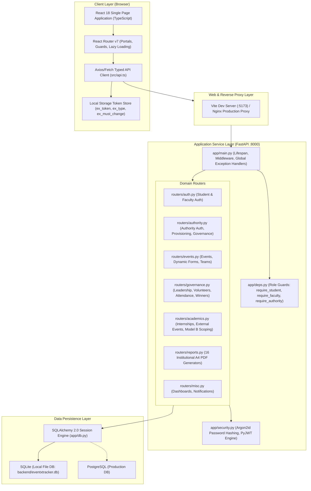

# EventXTracker — System Architecture Documentation
**Vidyavardhaka College of Engineering (VVCE), Mysuru**

## 1. Architectural Principles
EventXTracker is designed according to modern institutional software principles:
- **Separation of Concerns:** Strict decoupling between UI presentation (React/Vite), application business services (FastAPI), data persistence (SQLAlchemy 2.0 ORM), and authentication/authorization.
- **Three Isolated Portals:** Authority, Faculty, and Student portals operate with separate routing hierarchies, distinct navigation schemes, and non-overlapping authorization boundaries.
- **Dual-Model Scoping Engine:**
  - **Model A (Events):** Event operational visibility is college-wide by default. Department faculty may view event records for students belonging to their own department without needing a Class Teacher assignment. Faculty Event Coordinators have cross-department oversight for their assigned event.
  - **Model B (Academics):** Student submissions for internships and external technical events in `PENDING_REVIEW` are visible strictly to the exact assigned Class Teacher (`department + semester + section + academic_year`). Reviewed records become viewable by all faculty within the department. Cross-department access is denied.
- **Immutable Form Versioning:** Event registration schemas are stored as versioned immutable snapshots (`FormVersion`). Edits to an active form increment the version number, guaranteeing that historical responses retain their original schema.
- **Database Engine Portability:** Database interactions use SQLAlchemy 2.0 abstractions and standard relational constraints. SQLite is configured for local development (`DATABASE_URL=sqlite:///./eventxtracker.db`), and PostgreSQL is standard for production deployment (see [ADR-001-database.md](file:///Users/virat/MyPersonalCloud/eventxtracker%202/docs/ADR-001-database.md)).

---

## 2. Component Architecture

---

## 3. Portal Isolation and Routing Architecture

### 3.1 Authority Portal
- **Login:** `/authority/login` $\rightarrow$ `POST /api/v1/authority/auth/login`
- **Dashboard:** `/authority/dashboard`
- **Sub-views:**
  - Accounts Directory: `/authority/accounts`, `/authority/students`, `/authority/faculty`
  - Bulk Import: `/authority/bulk-import`
  - Department & Governance: `/authority/departments`, `/authority/hods`, `/authority/class-teachers`
  - Audit Trail: `/authority/audit-logs`
  - System Settings: `/authority/settings`
- **Guards:** Protected by `<Guard type="AUTHORITY">`. Any non-authority token or unauthenticated request redirects to `/authority/login`.

### 3.2 Faculty Portal
- **Login:** `/login` (Faculty Tab) $\rightarrow$ `POST /api/v1/auth/login` (Rejects Authority accounts with HTTP 403)
- **Dashboard:** `/faculty/dashboard`
- **Sub-views:**
  - Events Management: `/faculty/events`, `/faculty/events/create`, `/faculty/events/:id`
  - Form Builder: `/faculty/events/:id/form-builder`
  - Academic Verification: `/faculty/academic-reviews`
  - Student Directory: `/faculty/students`
- **Guards:** Protected by `<Guard type="FACULTY">`.

### 3.3 Student Portal
- **Login:** `/login` (Student Tab) $\rightarrow$ `POST /api/v1/auth/login` (Rejects Authority accounts with HTTP 403)
- **Dashboard:** `/student/dashboard`
- **Sub-views:**
  - Events & Details: `/student/events`, `/student/events/:id`
  - Registrations & Teams: `/student/registrations`, `/student/teams`, `/student/invitations`
  - Academic Submissions: `/student/internships`, `/student/external-events`
  - Achievements: `/student/achievements`
  - Profile & Security: `/student/profile`
- **Guards:** Protected by `<Guard type="STUDENT">`.

