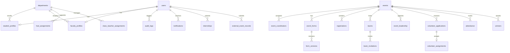

# EventXTracker — Database Schema & Entity Relationships
**Vidyavardhaka College of Engineering (VVCE), Mysuru**

## 1. Schema Overview
The relational database contains 24 tables with foreign key constraints, indexes on high-traffic filter columns, and audit history tracking.

---

## 2. Table Specifications

### 2.1 Core Identity & Access
- **`users`**:
  - `id` (INTEGER, PK)
  - `email` (VARCHAR(160), UNIQUE, INDEX)
  - `password_hash` (VARCHAR(255))
  - `account_type` (ENUM: `STUDENT`, `FACULTY`, `AUTHORITY`)
  - `status` (ENUM: `ACTIVE`, `PENDING_ACTIVATION`, `SUSPENDED`, `REVOKED`)
  - `must_change_password` (BOOLEAN, default: True)
  - `created_at` (DATETIME)
  - `updated_at` (DATETIME)

- **`student_profiles`**:
  - `id` (INTEGER, PK)
  - `user_id` (INTEGER, FK $\rightarrow$ `users.id`, UNIQUE)
  - `full_name` (VARCHAR(160))
  - `usn` (VARCHAR(32), UNIQUE, INDEX)
  - `department_id` (INTEGER, FK $\rightarrow$ `departments.id`)
  - `joining_year` (INTEGER)
  - `current_semester` (INTEGER)
  - `section` (VARCHAR(8))

- **`faculty_profiles`**:
  - `id` (INTEGER, PK)
  - `user_id` (INTEGER, FK $\rightarrow$ `users.id`, UNIQUE)
  - `full_name` (VARCHAR(160))
  - `department_id` (INTEGER, FK $\rightarrow$ `departments.id`)
  - `designation` (VARCHAR(80))

### 2.2 Institutional Structure & Governance
- **`departments`**:
  - `id` (INTEGER, PK)
  - `code` (VARCHAR(16), UNIQUE: CSE, ISE, AIML, EC, EEE, ME, CV)
  - `name` (VARCHAR(120))

- **`hod_assignments`**:
  - `id` (INTEGER, PK)
  - `department_id` (INTEGER, FK $\rightarrow$ `departments.id`)
  - `faculty_user_id` (INTEGER, FK $\rightarrow$ `users.id`)
  - `assigned_by` (INTEGER, FK $\rightarrow$ `users.id`)
  - `assigned_at` (DATETIME)
  - `revoked_at` (DATETIME, nullable)
  - `active` (BOOLEAN, default: True)

- **`class_teacher_assignments`**:
  - `id` (INTEGER, PK)
  - `department_id` (INTEGER, FK $\rightarrow$ `departments.id`)
  - `faculty_user_id` (INTEGER, FK $\rightarrow$ `users.id`)
  - `semester` (INTEGER)
  - `section` (VARCHAR(8))
  - `academic_year` (VARCHAR(16))
  - `assigned_by` (INTEGER, FK $\rightarrow$ `users.id`)
  - `assigned_at` (DATETIME)
  - `revoked_at` (DATETIME, nullable)
  - `active` (BOOLEAN, default: True)

### 2.3 Events & Form Architecture
- **`events`**:
  - `id` (INTEGER, PK)
  - `name` (VARCHAR(180))
  - `description` (TEXT)
  - `category` (VARCHAR(60))
  - `event_type` (VARCHAR(60))
  - `start_at` (DATETIME)
  - `end_at` (DATETIME)
  - `timezone` (VARCHAR(40))
  - `venue` (VARCHAR(160))
  - `reg_open_at` (DATETIME)
  - `reg_close_at` (DATETIME)
  - `individual_enabled` (BOOLEAN)
  - `team_enabled` (BOOLEAN)
  - `volunteer_enabled` (BOOLEAN)
  - `min_team_size` (INTEGER)
  - `max_team_size` (INTEGER)
  - `eligible_departments` (VARCHAR(120), comma-separated)
  - `eligible_semesters` (VARCHAR(60), comma-separated)
  - `status` (ENUM: `UPCOMING`, `LIVE`, `COMPLETED`, `CANCELLED`, `CLOSED`)
  - `created_by` (INTEGER, FK $\rightarrow$ `users.id`)

- **`event_coordinators`**:
  - `id` (INTEGER, PK)
  - `event_id` (INTEGER, FK $\rightarrow$ `events.id`)
  - `faculty_user_id` (INTEGER, FK $\rightarrow$ `users.id`)
  - `assigned_by` (INTEGER, FK $\rightarrow$ `users.id`)
  - `created_at` (DATETIME)

- **`event_forms`** & **`form_versions`**:
  - `event_forms`: `id`, `event_id`, `published_version`, `created_by`
  - `form_versions`: `id`, `form_id`, `version`, `schema_json` (JSON-encoded question array), `created_at`

### 2.4 Participation, Teams & Volunteers
- **`registrations`**:
  - `id` (INTEGER, PK)
  - `event_id` (INTEGER, FK $\rightarrow$ `events.id`)
  - `student_user_id` (INTEGER, FK $\rightarrow$ `users.id`)
  - `registration_id` (VARCHAR(32), UNIQUE)
  - `status` (VARCHAR(32): REGISTERED, SHORTLISTED, REJECTED)
  - `form_version` (INTEGER)
  - `answers_json` (TEXT)
  - `created_at` (DATETIME)

- **`teams`** & **`team_invitations`**:
  - `teams`: `id`, `event_id`, `team_name`, `project_title`, `leader_user_id`, `status` (`FORMATION`, `COMPLETE`, `SHORTLISTED`, `DISQUALIFIED`)
  - `team_invitations`: `id`, `team_id`, `student_user_id`, `status` (`PENDING`, `ACCEPTED`, `DECLINED`), `created_at`

- **`volunteer_applications`** & **`volunteer_assignments`**:
  - `volunteer_applications`: `id`, `event_id`, `student_user_id`, `skills`, `preferred_area`, `experience`, `availability`, `status` (`PENDING`, `APPROVED`, `REJECTED`), `recommended_by`
  - `volunteer_assignments`: `id`, `application_id`, `responsibility`, `allocation`, `completion_status` (`PENDING`, `COMPLETED`, `NOT_COMPLETED`), `assigned_by`, `verified_by`

- **`attendance`**:
  - `id` (INTEGER, PK)
  - `event_id` (INTEGER, FK $\rightarrow$ `events.id`)
  - `student_user_id` (INTEGER, FK $\rightarrow$ `users.id`)
  - `status` (VARCHAR(16): `PRESENT`, `ABSENT`, `EXCUSED`)
  - `marked_by` (INTEGER, FK $\rightarrow$ `users.id`)
  - `marked_at` (DATETIME)

- **`winners`**:
  - `id` (INTEGER, PK)
  - `event_id` (INTEGER, FK $\rightarrow$ `events.id`)
  - `position` (INTEGER)
  - `student_user_id` (INTEGER, FK $\rightarrow$ `users.id`, nullable)
  - `team_id` (INTEGER, FK $\rightarrow$ `teams.id`, nullable)
  - `achievement` (VARCHAR(120))
  - `created_by` (INTEGER, FK $\rightarrow$ `users.id`)

### 2.5 Academics & Auditing
- **`internships`** & **`external_event_records`**:
  - Scoped by student profile department, semester, section, academic year.
  - Verification fields: `status` (`PENDING_REVIEW`, `VERIFIED`, `REJECTED`, `ON_HOLD`), `evidence_inspected` (BOOLEAN), `reviewed_by` (INTEGER, FK $\rightarrow$ `users.id`), `reviewed_at` (DATETIME).

- **`audit_logs`**:
  - `id` (INTEGER, PK)
  - `actor_id` (INTEGER, FK $\rightarrow$ `users.id`, nullable)
  - `action` (VARCHAR(80))
  - `entity` (VARCHAR(80))
  - `entity_id` (INTEGER, nullable)
  - `detail` (TEXT, nullable)
  - `created_at` (DATETIME, INDEX)

