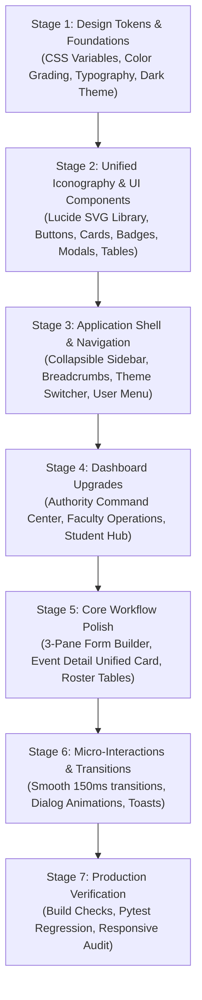

# EVENTXTRACKER — COMPREHENSIVE UI/UX AUDIT
## Baseline Inspection, Visual Inconsistencies & Transformation Roadmap

**Audit Date:** November 2026  
**Auditor:** Senior UI/UX Architect & Principal Product Designer  
**Scope:** Authority Portal, Faculty Portal, Student Portal, Shared Navigation Shell, Component System, Dynamic Form Builder, and Responsive Viewports.

---

### 1. Executive Summary

EventXTracker is an institutional-scale college event and academic management platform built with FastAPI, SQLite, React 19, Vite, and Tailwind CSS. While the backend services and business logic are comprehensive and functional across all three portals, the user interface currently exhibits traits of early-stage enterprise prototyping:
- Heavy reliance on emojis for navigation and actions (`🏛️`, `🎪`, `📜`, `🎯`, `👥`, `📝`, `🔔`, `👑`, `🔐`, `🚪`).
- Lack of centralized design tokens and CSS variables.
- Absence of a cohesive dark mode theme.
- Inconsistent typographic hierarchy and card padding across portals.
- Raw tables without sticky headers, refined pagination, or standardized empty/loading states.
- The Dynamic Form Builder layout is functional but fragmented rather than following the modern 3-pane SaaS standard (Palette | Canvas | Settings).

This audit documents every visual and interaction deficiency, establishing a concrete execution plan for a production-grade, Linear/Vercel/Stripe-inspired transformation.

---

### 2. Route & Layout Inventory

| Route | Portal / Role | Primary Component | Current Visual State | Key Deficiencies |
|---|---|---|---|---|
| `/authority/login` | Authority | `AuthorityLogin.tsx` | Functional standalone card | Raw slate-900 background, lacks theme tokens & smooth card elevations |
| `/student/login` | Student | `StudentLogin.tsx` | Functional standalone card | Inconsistent button sizing, basic inputs |
| `/faculty/login` | Faculty | `FacultyLogin.tsx` | Functional standalone card | Inconsistent button sizing, basic inputs |
| `/authority/dashboard` | Authority | `AuthorityDashboard.tsx` | 6 Tabs (Overview, Accounts, Provision, Bulk, Governance, Audit) | Dense tables lack sticky headers, KPI cards have mixed border radii, emojis used for tab icons |
| `/authority/accounts` | Authority | `AuthorityDashboard.tsx` | Accounts directory table | Filter bar lacks unified search container, status tags use inconsistent semantic colors |
| `/authority/departments` | Authority | `AuthorityDashboard.tsx` | Departments, HODs, CT governance | Modals lack backdrop blur and clean header/footer action separation |
| `/authority/audit-logs` | Authority | `AuthorityDashboard.tsx` | Audit logs stream | Monospaced logs lack visual grouping, timestamp formatting varies |
| `/faculty/dashboard` | Faculty | `FacultyDashboard.tsx` | 3-Menu Split (Normal, Special, Class Teacher) | Left sidebar has emoji icons; metric badges have inconsistent padding; department student roster lacks modern export toolbar |
| `/faculty/events/create` | Faculty | `FacultyDashboard.tsx` | Create Event form | Form inputs lack subtle focus rings and structured fieldsets; date pickers use default browser chrome |
| `/faculty/events/active` | Faculty | `FacultyDashboard.tsx` | Active events roster | Event cards lack standardized metadata grid and status chip hierarchy |
| `/faculty/events/history` | Faculty | `FacultyDashboard.tsx` | Archive & PDF exports | Action buttons have uneven heights; report export items look like plain boxes |
| `/faculty/class-teacher/reviews` | Faculty | `FacultyDashboard.tsx` | Academic reviews queue | Review cards are text-heavy without clean verification status chips |
| `/student/dashboard` | Student | `StudentDashboard.tsx` | 3-Menu Split (Normal, Special, Academic) | Profile hero section has redundant cards; registered participations and volunteering lack status timeline indicators |
| `/student/coordination` | Student | `StudentDashboard.tsx` | Leadership workspace | Shortlisting controls for President/VP lack clear confirmation states |
| `/student/academics` | Student | `StudentDashboard.tsx` | Internships & External events | Submission modals lack multi-step wizard feel and document preview chips |
| `/events` | Campus | `Events.tsx` | College-wide event directory | Event grid cards lack image banner fallback placeholders, tags look cluttered |
| `/events/:id` | Campus | `EventDetail.tsx` | Unified Apply & Register + Mgmt | Tabs have mixed styles; leadership tables lack sticky headers; fee payment flow needs clear step indicators |
| `/faculty/events/:id/form-builder`| Faculty | `DynamicFormBuilder.tsx` | Google Forms-style builder | Question canvas is monolithic; lacks dedicated 3-pane layout (Palette, Canvas, Inspector); conditional logic rules look cluttered |

---

### 3. Detailed Visual & Interaction Deficiencies

#### 3.1 Color System & Design Tokens
- **Problem**: Colors are hardcoded using random Tailwind classes (`bg-slate-50`, `bg-vvce-700`, `bg-sky-950`, `text-amber-800`).
- **Deficiency**: No CSS variables or semantic tokens (`--bg-primary`, `--bg-surface`, `--text-primary`, `--action-primary`).
- **Impact**: Portal-specific accents (Authority Deep Navy, Faculty Deep Teal, Student Deep Indigo) feel disjointed rather than intentional subtle identity accents.
- **Dark Mode**: Completely missing. Toggling dark mode produces illegible high-contrast inverted artifacts if attempted with standard browser extensions.

#### 3.2 Iconography & Typography
- **Problem**: Navigation and headers use arbitrary OS-rendered Unicode emojis (`🏛️`, `🎪`, `📜`, `🎯`, `👥`, `📝`, `🔔`, `👑`, `🔐`, `🚪`, `➕`, `📊`).
- **Deficiency**: Emojis render inconsistently across macOS, Windows, Linux, Android, and iOS, breaking enterprise SaaS aesthetic standards.
- **Remedy**: Replace all navigation emojis with unified, pixel-perfect Lucide SVG icons with standardized `16px`/`18px`/`20px` bounding boxes and `1.75px` stroke widths.
- **Typography**: Headings lack uniform tracking and line-heights. Numerical statistics lack tabular figures (`font-variant-numeric: tabular-nums`).

#### 3.3 Navigation Shell (`Layout.tsx`)
- **Problem**: Sidebar is static and permanently consumes 256px on desktop without a sleek collapsible mini-rail state.
- **Top Bar**: Minimalist to a fault — only displays an institution title text and bell icon without breadcrumbs, active workspace indicator, search shortcut (`Cmd+K`), or dark/light theme switch.
- **User Footer**: Basic "Sign out" button without an avatar chip, role pill, or account switch indicator.

#### 3.4 Data Tables & Lists
- **Deficiencies**:
  - Table headers lack sticky positioning (`sticky top-0`) when scrolling long lists.
  - Table row hovers are abrupt rather than using subtle CSS transitions.
  - Status badges use saturated backgrounds instead of subtle tinted pill badges.
  - Search inputs lack standard prefix search icons and `Cmd+K` indicators.

#### 3.5 Dynamic Form Builder (`DynamicFormBuilder.tsx`)
- **Deficiencies**:
  - The builder stacks question cards in a single long scroll view with inline modals.
  - Modern form builders (Typeform, Linear, Retool, Vercel) utilize a 3-pane layout:
    1. **Left Rail**: Draggable/clickable question palette (Text, Choice, File, Scale, Section).
    2. **Center Canvas**: Interactive live form canvas with reorder handles, section dividers, and conditional visibility pills.
    3. **Right Inspector**: Selected question configuration (Validation, Regex, Min/Max, Options, Required toggle).
    4. **Top Bar**: Form title, auto-save status, Version pill (`v2`), Preview toggle, and Publish button.

#### 3.6 Mobile Responsiveness
- **Deficiencies**:
  - Tables in `AuthorityDashboard.tsx` and `EventDetail.tsx` cause horizontal layout expansion on viewports below 400px.
  - Multi-column metric grids (`grid-cols-4`) don't scale gracefully to single columns on small viewports.

---

### 4. Transformation Roadmap & Phased Execution Plan

---

### 5. Architectural Commitments
1. **Zero Business Logic Loss**: All API endpoints (`/api/v1/*`), authentication tokens, role guards, and data schemas remain 100% intact.
2. **Real Data Persistence**: No mock data or fake statistics introduced.
3. **No External Network Dependencies**: Self-contained SVG Lucide icon system ensuring sandbox compliance and zero external bundle bloat.
4. **Accessible Contrast**: All color tokens strictly meet WCAG AA standards in both light and dark themes.

